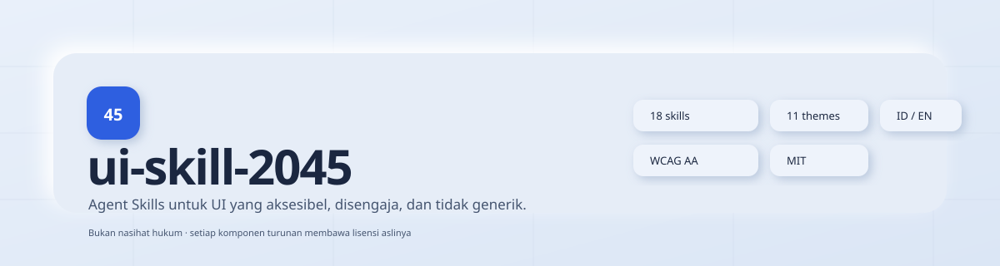

<div align="center">



[](skills.json)
[](docs/themes/README.md)
[](LICENSE)
[](docs/themes/README.md)
[](#bahasa)

</div>

# ui-skill-2045

**Agent Skills untuk antarmuka yang aksesibel, disengaja, dan tidak generik.**

Angka **2045** adalah arah, bukan klaim: antarmuka masa depan yang sudah bisa dipakai hari ini.
Repositori ini berisi **18 skill** yang ditulis ulang dari sumber berlisensi permisif, **11 tema**
lengkap dengan token dan preview, CLI instalasi, validator, dan situs katalog statis.

> Repositori ini **tidak berafiliasi** dengan Anthropic, Paul Bakaus, Next Level Builder,
> Leonxlnx, Meng To, Julien Thibeaut, palamut62, atau Vercel Labs. Setiap komponen turunan
> mempertahankan lisensi dan copyright aslinya. Lihat [THIRD_PARTY_NOTICES.md](THIRD_PARTY_NOTICES.md).
> **Bukan nasihat hukum.**

---

## Daftar isi

- [Mengapa repo ini ada](#mengapa-repo-ini-ada)
- [Instalasi](#instalasi)
- [Daftar skill](#daftar-skill)
- [Tema](#tema)
- [CLI](#cli)
- [Memakai skill di setiap agent](#memakai-skill-di-setiap-agent)
- [Situs preview](#situs-preview)
- [Struktur repositori](#struktur-repositori)
- [Kontribusi](#kontribusi)
- [Lisensi dan atribusi](#lisensi-dan-atribusi)
- [FAQ](#faq)
- [Langkah manual untuk pemilik](#langkah-manual-untuk-pemilik)

---

## Mengapa repo ini ada

Kebanyakan halaman buatan agen tidak buruk; ia hanya **tidak memutuskan apa pun**. Inter untuk
semuanya, gradien ungu-biru, kartu SaaS yang identik, label kapital berjarak lebar, dan animasi
fade-up di setiap bagian. Skill di repositori ini mengganti default itu dengan prosedur:

- kapan skill dipakai, dan kapan tidak;
- input yang harus ditanyakan ke pengguna;
- langkah kerja berurutan;
- aturan keputusan dan nilai default;
- daftar larangan;
- checklist sebelum menyerahkan hasil;
- contoh prompt dan contoh hasil;
- ringkasan **Bahasa Indonesia** di setiap skill.

Semuanya ditulis ulang. Tidak ada folder skill upstream yang disalin mentah.

### Yang kamu dapat

| | |
|---|---|
| **18 skill** | Fondasi, komponen, interaksi, kualitas, stack, dan tema |
| **11 tema** | Token light + dark, kontras terukur, preview mandiri |
| **88 uji kontras** | Otomatis, gagal build bila ada pasangan teks di bawah AA |
| **Dua bahasa** | Instruksi inti Inggris + ringkasan Indonesia; situs dan preview ID/EN |
| **Tiga jalur instalasi** | CLI skills umum, npm `ui-skill-2045`, clone/zip manual |
| **Validator CI** | Frontmatter, nama folder, preview, atribusi, tautan, ukuran file |
| **Preview mandiri** | Setiap skill punya `preview/index.html` tanpa dependensi eksternal |

---

## Instalasi

> **Tinjau skill sebelum menginstal.** Skill adalah instruksi yang dijalankan agen. Baca
> `SKILL.md` dan `references/` terlebih dahulu, terutama bila kamu memakai agen dengan akses
> menulis ke repositori.

### 1. CLI skills umum (kompatibilitas)

Repositori ini disusun mengikuti konvensi Agent Skills (`skills/<nama>/SKILL.md`), sehingga dapat
dipasang dengan CLI skills umum:

```bash
npx skills add dresar/ui-skill-2045
npx skills add dresar/ui-skill-2045 --skill anti-slop-design
```

Repositori: `dresar/ui-skill-2045`. Perilaku persisnya bergantung pada versi CLI
`skills` yang kamu pakai; jika CLI tersebut tidak mengenali repo ini, gunakan jalur npm di bawah.

### 2. Paket npm

```bash
npx ui-skill-2045 list
npx ui-skill-2045 add anti-slop-design
npx ui-skill-2045 add --all
npx ui-skill-2045 add --theme soft-blue-neumorphism
npx ui-skill-2045 add --all --agent cursor
npx ui-skill-2045 add --all --dir .claude/skills
npx ui-skill-2045 remove dark-mode
npx ui-skill-2045 update
```

Paket ini **belum dipublikasikan ke npm** saat repo ini dibuat. Sampai pemilik menjalankan
`npm publish` di `packages/cli`, gunakan `node packages/cli/bin/ui-skill-2045.js` dari hasil clone.

### 3. Manual (clone, salin, atau zip)

```bash
git clone https://github.com/dresar/ui-skill-2045.git
cp -r ui-skill-2045/skills/anti-slop-design .agents/skills/
```

Atau unduh ZIP dari halaman **GitHub Releases** repositori ini. ZIP rilis dibuat oleh workflow
`.github/workflows/release.yml`.

---

## Daftar skill

Semua skill berlisensi MIT untuk karya baru; komponen turunan tetap tunduk pada lisensi aslinya.

| Skill | Kategori | Untuk | Sumber | Lisensi asli |
|---|---|---|---|---|
| [`design-system-tokens`](skills/design-system-tokens/SKILL.md) | fondasi | Token tiga lapis, light/dark, skala 4px | [ibelick/ui-skills](https://github.com/ibelick/ui-skills) | MIT |
| [`typography-system`](skills/typography-system/SKILL.md) | fondasi | Skala tipe, measure, hierarki, pemuatan font | [anthropics/skills](https://github.com/anthropics/skills) | Apache-2.0 |
| [`color-contrast`](skills/color-contrast/SKILL.md) | fondasi | Palet, kontras WCAG, status | [nextlevelbuilder](https://github.com/nextlevelbuilder/ui-ux-pro-max-skill) | MIT |
| [`spacing-layout`](skills/spacing-layout/SKILL.md) | fondasi | Grid, irama seksi, ruang | [Leonxlnx/taste-skill](https://github.com/Leonxlnx/taste-skill) | MIT |
| [`ui-components`](skills/ui-components/SKILL.md) | komponen | Button, card, form, tabel, navigasi | [MengTo/Skills](https://github.com/MengTo/Skills) | MIT |
| [`dashboard-admin`](skills/dashboard-admin/SKILL.md) | komponen | Dashboard, admin, metrik, antrean | [Leonxlnx/taste-skill](https://github.com/Leonxlnx/taste-skill) | MIT |
| [`empty-error-states`](skills/empty-error-states/SKILL.md) | komponen | Empty, error, loading, 404/500 | [pbakaus/impeccable](https://github.com/pbakaus/impeccable) | Apache-2.0 |
| [`motion-system`](skills/motion-system/SKILL.md) | interaksi | Transisi, reduced motion, anggaran gerak | [MengTo/Skills](https://github.com/MengTo/Skills) | MIT |
| [`accessibility-wcag`](skills/accessibility-wcag/SKILL.md) | interaksi | Keyboard, screen reader, focus, reflow | [ibelick/ui-skills](https://github.com/ibelick/ui-skills) | MIT |
| [`responsive-adaptive`](skills/responsive-adaptive/SKILL.md) | interaksi | Mobile, container query, strategi tabel | [nextlevelbuilder](https://github.com/nextlevelbuilder/ui-ux-pro-max-skill) | MIT |
| [`dark-mode`](skills/dark-mode/SKILL.md) | interaksi | Dark mode, elevasi, aksen, flash | [nextlevelbuilder](https://github.com/nextlevelbuilder/ui-ux-pro-max-skill) | MIT |
| [`ux-writing`](skills/ux-writing/SKILL.md) | interaksi | Microcopy, error, bilingual ID/EN | [anthropics/skills](https://github.com/anthropics/skills) | Apache-2.0 |
| [`ui-audit-review`](skills/ui-audit-review/SKILL.md) | kualitas | Audit 14 pass, severity P0–P3 | [pbakaus/impeccable](https://github.com/pbakaus/impeccable) | Apache-2.0 |
| [`anti-slop-design`](skills/anti-slop-design/SKILL.md) | kualitas | Arah seni, ide, anti-template | [Leonxlnx](https://github.com/Leonxlnx/taste-skill) + [Impeccable](https://github.com/pbakaus/impeccable) + [Anthropic](https://github.com/anthropics/skills) | MIT + Apache-2.0 |
| [`frontend-performance`](skills/frontend-performance/SKILL.md) | teknik | LCP, CLS, INP, gambar, font, bundle | [ibelick/ui-skills](https://github.com/ibelick/ui-skills) | MIT |
| [`nextjs-react-patterns`](skills/nextjs-react-patterns/SKILL.md) | teknik | App Router, server/client, form, export | **Karya asli** (referensi Vercel Labs, tidak disalin) | MIT |
| [`tailwind-shadcn`](skills/tailwind-shadcn/SKILL.md) | teknik | Token, varian, aksesibilitas shadcn | [MengTo/Skills](https://github.com/MengTo/Skills) | MIT |
| [`theme-recipes`](skills/theme-recipes/SKILL.md) | tema | 11 tema, satu kontrak token | [MengTo/Skills](https://github.com/MengTo/Skills) + [nextlevelbuilder](https://github.com/nextlevelbuilder/ui-ux-pro-max-skill) | MIT |

Registry mesin: [`skills.json`](skills.json) (dibuat otomatis, jangan diedit manual).

### Kategori yang tercakup

Design system dan token · tipografi · warna dan kontras · spacing dan layout · komponen ·
dashboard/admin · empty dan error state · motion · aksesibilitas · responsif · dark mode ·
microcopy · audit dan review · anti-slop · performa · Next.js/React · Tailwind/shadcn · tema.

---

## Tema

Setiap tema punya dokumentasi lengkap (filosofi, kapan dipakai/dihindari, palet light + dark,
radius, bayangan, border, tipografi, spacing, motion, contoh komponen, larangan) dan preview HTML
mandiri. Semua pasangan teks diverifikasi otomatis terhadap WCAG AA.

| Tema | Untuk | Preview | Dokumen |
|---|---|---|---|
| **Soft Blue Neumorphism** (utama) | Produk tenang, dashboard, settings | [preview](docs/themes/previews/soft-blue-neumorphism.html) | [dokumen](docs/themes/soft-blue-neumorphism.md) |
| Glassmorphism | Hero media, overlay, toolbar | [preview](docs/themes/previews/glassmorphism.html) | [dokumen](docs/themes/glassmorphism.md) |
| Aurora Gradient | Campaign, creative tools | [preview](docs/themes/previews/aurora-gradient.html) | [dokumen](docs/themes/aurora-gradient.md) |
| Minimal Monochrome | Portofolio, editorial, tools | [preview](docs/themes/previews/minimal-monochrome.html) | [dokumen](docs/themes/minimal-monochrome.md) |
| Brutalist Modern | Budaya, studio, statement | [preview](docs/themes/previews/brutalist-modern.html) | [dokumen](docs/themes/brutalist-modern.md) |
| Cyber Neon | Gaming, dev tools, malam | [preview](docs/themes/previews/cyber-neon.html) | [dokumen](docs/themes/cyber-neon.md) |
| Dark Neumorphism | Media app, control panel | [preview](docs/themes/previews/dark-neumorphism.html) | [dokumen](docs/themes/dark-neumorphism.md) |
| Bento Grid | Feature overview, marketing | [preview](docs/themes/previews/bento-grid.html) | [dokumen](docs/themes/bento-grid.md) |
| Editorial Serif | Publishing, hospitality | [preview](docs/themes/previews/editorial-serif.html) | [dokumen](docs/themes/editorial-serif.md) |
| Claymorphism | Consumer, edukasi | [preview](docs/themes/previews/claymorphism.html) | [dokumen](docs/themes/claymorphism.md) |
| Blueprint Grid (masa depan) | Developer tools, dokumentasi | [preview](docs/themes/previews/blueprint-grid.html) | [dokumen](docs/themes/blueprint-grid.md) |

Token siap pakai: [`skills/theme-recipes/assets/themes.css`](skills/theme-recipes/assets/themes.css).

---

## CLI

```text
npx ui-skill-2045 list [--json]
npx ui-skill-2045 add <skill> [--agent <agent>] [--dir <path>] [--force]
npx ui-skill-2045 add --all
npx ui-skill-2045 add --theme <theme>
npx ui-skill-2045 remove <skill>
npx ui-skill-2045 update
```

| Opsi | Arti |
|---|---|
| `--skill <name>` | Alias `add <name>` untuk kompatibilitas |
| `--all` | Semua skill |
| `--theme <slug>` | Semua skill yang mendukung tema |
| `--agent <name>` | `claude`, `agents`, `codex`, `cursor`, `github`, `copilot`, `gemini`, `windsurf`, `antigravity` |
| `--dir <path>` | Tujuan eksplisit, mengalahkan `--agent` |
| `--force` | Menimpa folder skill yang sudah ada |
| `--json` | Keluaran mesin untuk `list` |

**Keamanan:** tanpa `--force`, CLI tidak pernah menimpa folder yang sudah ada. `remove` menolak
menghapus direktori yang tidak memiliki `SKILL.md`. Tes CLI ada di
[`packages/cli/test/cli.test.js`](packages/cli/test/cli.test.js).

---

## Memakai skill di setiap agent

| Agent | Lokasi proyek | Perintah |
|---|---|---|
| Claude Code | `.claude/skills/` | `npx ui-skill-2045 add --all --agent claude` |
| Codex | `.codex/skills/` | `npx ui-skill-2045 add --all --agent codex` |
| Agent Skills generik | `.agents/skills/` | `npx ui-skill-2045 add --all --agent agents` |
| GitHub Copilot | `.github/skills/` | `npx ui-skill-2045 add --all --agent github` |
| Cursor | `.cursor/skills/` | `npx ui-skill-2045 add --all --agent cursor` |
| Gemini CLI | `.gemini/skills/` | `npx ui-skill-2045 add --all --agent gemini` |
| Windsurf | `.windsurf/skills/` | `npx ui-skill-2045 add --all --agent windsurf` |
| Antigravity | `.agent/skills/` | `npx ui-skill-2045 add --all --agent antigravity` |

Bila CLI agen kamu memakai folder lain, gunakan `--dir`. Setelah menyalin, muat ulang agen agar
skill terdeteksi. Beberapa agen meminta persetujuan untuk skill tingkat proyek — baca isinya
sebelum menyetujui.

---

## Situs preview

Situs statis Next.js (App Router, TypeScript) berada di [`site/`](site/). Setelah di-deploy ke
GitHub Pages, URL-nya:

```text
https://dresar.github.io/ui-skill-2045/
```

URL tersebut aktif setelah GitHub Pages diaktifkan dengan sumber **GitHub Actions**.

Fitur situs: beranda dengan pencarian, galeri dengan filter tema/kategori/tag dan pagination
20 item (grid 2 kolom mobile, 4 kolom desktop), halaman detail per skill dengan perintah instalasi
dan tombol salin, preview HTML di panel inline (bukan modal), katalog tema dengan swatch, halaman
instalasi, kontribusi, atribusi, sitemap, Open Graph, light/dark, ID/EN, dan reduced motion.

### Mengaktifkan GitHub Pages

1. Buka **Settings → Pages**.
2. Pada **Build and deployment → Source**, pilih **GitHub Actions**.
3. Push ke branch utama. Workflow `deploy-site.yml` akan build dan deploy.
4. Tunggu job `deploy` selesai, lalu buka `https://dresar.github.io/ui-skill-2045/`.

Konfigurasi `basePath` dan `assetPrefix` sudah diset ke `/ui-skill-2045` di
[`site/next.config.ts`](site/next.config.ts). `.nojekyll` disertakan di `site/public/`.

---

## Struktur repositori

```text
ui-skill-2045/
├── skills/<nama>/
│   ├── SKILL.md              # frontmatter wajib + instruksi
│   ├── references/           # detail tambahan (opsional)
│   ├── assets/               # token CSS (opsional)
│   ├── preview/index.html    # preview mandiri
│   ├── LICENSE-UPSTREAM*     # lisensi asli (wajib untuk turunan)
│   ├── NOTICE-UPSTREAM.md    # NOTICE Apache (bila ada)
│   └── MODIFICATIONS.md      # ringkasan perubahan
├── site/                     # Next.js static export
├── packages/cli/             # paket npm ui-skill-2045
├── scripts/                  # generator registry, tema, preview, validator
├── docs/                     # sumber, tema, aset, lisensi upstream
├── evals/                    # 3 prompt + rubrik per skill
├── tests/                    # dokumentasi strategi tes
├── .github/workflows/        # CI, deploy Pages, release ZIP
├── skills.json               # registry hasil generate
├── THIRD_PARTY_NOTICES.md
├── LICENSE
└── README.md
```

---

## Kontribusi

Lihat [`CONTRIBUTING.md`](CONTRIBUTING.md). Ringkasnya:

1. Baca sumbernya sampai habis; jangan menyalin tanpa lisensi.
2. Tulis ulang, jangan tempel. Tambahkan contoh dan checklist.
3. Jalankan `npm run build:skills` lalu `npm run validate`.
4. Jalankan `npm test`.
5. Buka PR. CI akan menjalankan validator pada setiap PR.

---

## Lisensi dan atribusi

- Karya asli di repositori ini: **MIT**, `Copyright (c) 2026 EKA SYARIF MAULANA`.
- Komponen turunan: tetap tunduk pada lisensi aslinya (MIT atau Apache-2.0).
- Teks lisensi asli disimpan di setiap skill (`LICENSE-UPSTREAM*`) dan di
  [`docs/upstream-licenses/`](docs/upstream-licenses/).
- Sumber Apache-2.0 menyertakan `NOTICE-UPSTREAM.md`; NOTICE asli juga direproduksi di
  [`THIRD_PARTY_NOTICES.md`](THIRD_PARTY_NOTICES.md).
- Sumber yang ditolak dan alasannya: [`docs/rejected-sources.md`](docs/rejected-sources.md).

**Lisensi root tidak menggantikan lisensi upstream.** Bila terjadi konflik pada file turunan,
lisensi upstream yang berlaku untuk file tersebut.

---

## FAQ

**Apakah ini kumpulan skill resmi Anthropic/Vercel?**
Tidak. Ini kurasi independen. Tidak ada afiliasi atau dukungan.

**Apakah skill ini bisa dipakai dengan agen selain Claude?**
Ya. Formatnya `SKILL.md` dengan frontmatter YAML, dan CLI mendukung beberapa lokasi agen.

**Kenapa hanya 18 skill, bukan 100?**
Karena skill yang tumpang tindih menciptakan instruksi yang saling bertentangan. 18 skill ini
mencakup seluruh kategori yang diminta tanpa duplikasi.

**Apakah preview butuh internet?**
Tidak. Setiap `preview/index.html` mandiri, tanpa font, gambar, atau skrip eksternal.

**Apakah tema benar-benar lolos WCAG AA?**
Pasangan teks/latar diukur dengan rumus WCAG dan build gagal bila di bawah ambang. Itu bukan
audit aksesibilitas penuh; uji keyboard dan screen reader tetap diperlukan.

**Bolehkah saya memakai skill ini secara komersial?**
Karya asli MIT. Komponen turunan mengikuti lisensi aslinya; periksa `LICENSE-UPSTREAM` di setiap
skill. Bukan nasihat hukum.

---

## Langkah manual untuk pemilik

1. **Aktifkan GitHub Pages** dengan sumber **GitHub Actions**.
2. **Publikasikan paket npm**: `cd packages/cli && npm publish --access public`.
3. **Buat rilis bertag** agar workflow `release.yml` menghasilkan ZIP skill.
4. **Tinjau** `THIRD_PARTY_NOTICES.md` dan `docs/sources.md` sebelum penggunaan komersial.
5. **Rotasi token** yang tertulis di file skill lokal `auto-git-commit-push` dan hapus dari disk.

---

<div align="center">

Dibuat dengan prosedur, bukan template. · [PLAN.md](PLAN.md) · [Sumber](docs/sources.md) ·
[Atribusi](THIRD_PARTY_NOTICES.md)

</div>
